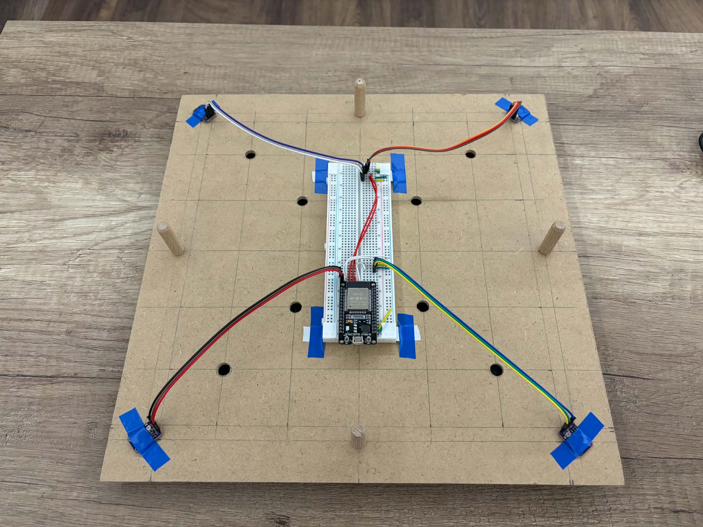

# Sound Source Localization with 4 Microphones on an ESP32

*Négymikrofonos hangforrás-lokalizáció beágyazott rendszeren. Okos Eszközök Laboratórium, 2026 ősz. A részletes, magyar nyelvű leírás: [docs/final_report/zarojelentes.pdf](docs/final_report/zarojelentes.pdf).*

An embedded sound source localization system:
- **Hardware:** four electret microphones in a square, an ESP32 that does all the signal processing, and a smartphone as the test sound source.
- **On the ESP32:**
  1. It finds a known test chirp (3–12 kHz, 50 ms) with a matched filter.
  2. It estimates the time differences of arrival between the 6 mic pairs with **GCC-PHAT** (sub-sample, 1/16 sample).
  3. It computes the source **direction** and **3D position**.
- **On the laptop:** Python tools drive the phone, run the measurement campaigns, evaluate the data, and show the result live in the browser.

<p align="center"></p>

## Results in brief

The system was measured with three layouts: a 10, 20 and 30 cm square. Each layout was measured at 80 known positions up to 3 m away, with more than 5000 chirps in total.

| | 30 cm | 20 cm | 10 cm |
|---|---|---|---|
| Direction error (median, source 50–170 cm above the mics) | 0.3–0.7° | 0.6–1.2° | 1.1–3.4° |
| 3D position error, z = 50 cm / 90 cm (median) | 5.6 / 10.3 cm | 15.5 / 40.2 cm | 54.7 / 77.4 cm |

- **Timing is very repeatable.** The chirp-to-chirp repeatability of the delays is about 0.65 µs, which is 1/35 of a sample.
- **Direction is robust, distance is not.** A planar array sees the distance only through the curvature of the wavefront.
- **Error model.** The position error follows **3D error ≈ G · σ**. G is the geometric sensitivity, which depends only on the source position and the array size. σ ≈ 1–2 µs is the effective timing error of the whole chain.
- **Live demo.** Because direction is the reliable quantity, the demo intersects the measured direction with a plane at a known height.

## Repository layout

```
firmware/                ESP32 firmware (PlatformIO, Arduino/ESP-IDF)
  src/main.cpp           sampling (core 1), DSP task (core 0), serial commands, JSON output
  lib/tdoa/              detector (matched filter), GCC-PHAT, localization; also builds on a PC
  test_native/           runs the same DSP code on a PC on a recording
host/                    laptop side (Python 3.10)
  live_app.py, live/     live localization demo (browser view + phone as source)
  series.py, plans/      phone-driven measurement campaign over a grid of known points
  bench.py               test-signal comparison (sweeps of 25 signals)
  phone_server.py, phone/  web page that turns a phone into the remote-controlled sound source
  esp_link.py, signals_lib.py, localize.py   serial link, test signals, geometry/localization model
  analyze_series.py, analyze_sweeps.py, build_dashboard.py, report_figures.py, ...   evaluation
  bench_results/         raw data of all measurements (JSON lines, one file per placement)
docs/
  final_report/          final report (Hungarian): zarojelentes.md -> zarojelentes.pdf
  dashboard/index.html   interactive analysis page (3D view, filters, every chirp)
  MANUAL.md              how to flash the firmware and start the host
  experiment_log.md      lab notebook: every run, analysis and decision
  reproduce.md           parameters, protocol and code history to repeat the measurements
  code_snapshots/        exact code of each measurement run
```

## Quick start

Full details are in [docs/MANUAL.md](docs/MANUAL.md).

```bash
python3 -m venv .venv && source .venv/bin/activate
pip install -r host/requirements.txt

cd firmware && pio run -e esp32 -t upload      # flash the ESP32 (USB, /dev/ttyUSB0)
cd ../host && python live_app.py               # live demo: open http://localhost:8766/
```

On the phone (same network), open the address the program prints, then tap **Tap to start audio** and **Start sound**. Hold the phone about 1 m above the microphones.

There is also a demo mode with no hardware, which replays recorded measurements: `python live_app.py --demo`.

## Hardware

- **Board:** ESP32 dev board (ESP32-DevKit).
- **Microphones:** 4 analog electret modules with amplifiers on ADC1 (GPIO34, 35, 32, 33).
- **Sampling:** 44.1 kHz per microphone, each sample the average of 4 ADC readings (705.6 kS/s in DMA mode).
- **Layout:** the square is 10, 20 or 30 cm. Mic1 (−h, +h), Mic2 (+h, +h), Mic3 (+h, −h), Mic4 (−h, −h), with h = side/2.
- **Sound source:** any smartphone with a browser, playing the chirp from the bottom speaker.

## Data and evaluation

| What | Where | Rebuild |
|---|---|---|
| Raw data of the distance campaign | `host/bench_results/series/distance_v2/a30`, `a20`, `a10` | — |
| Interactive analysis page | `docs/dashboard/index.html` | `python host/build_dashboard.py` |
| Figures of the report | `docs/report/` | `python host/identify_system.py`, then `python host/report_figures.py` |
| Report PDF | `docs/final_report/zarojelentes.pdf` | `python docs/final_report/build_pdf.py` |
