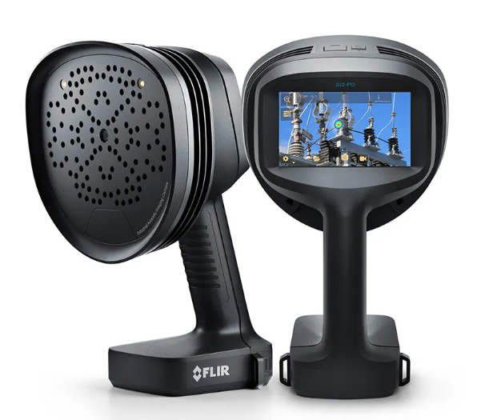
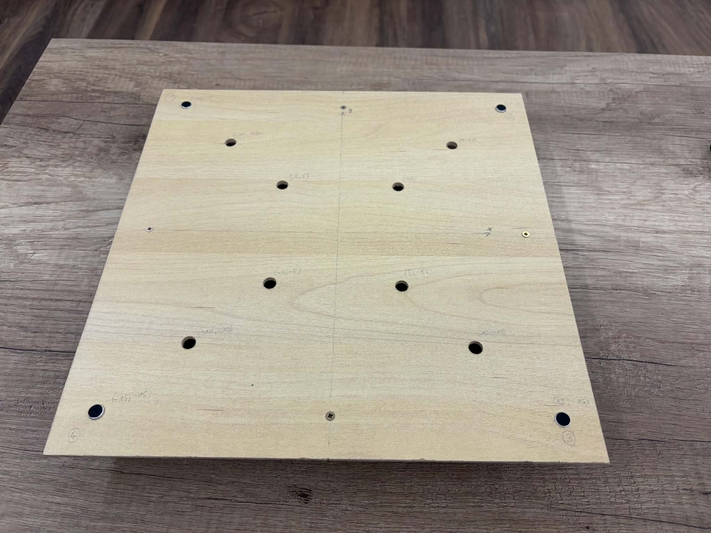
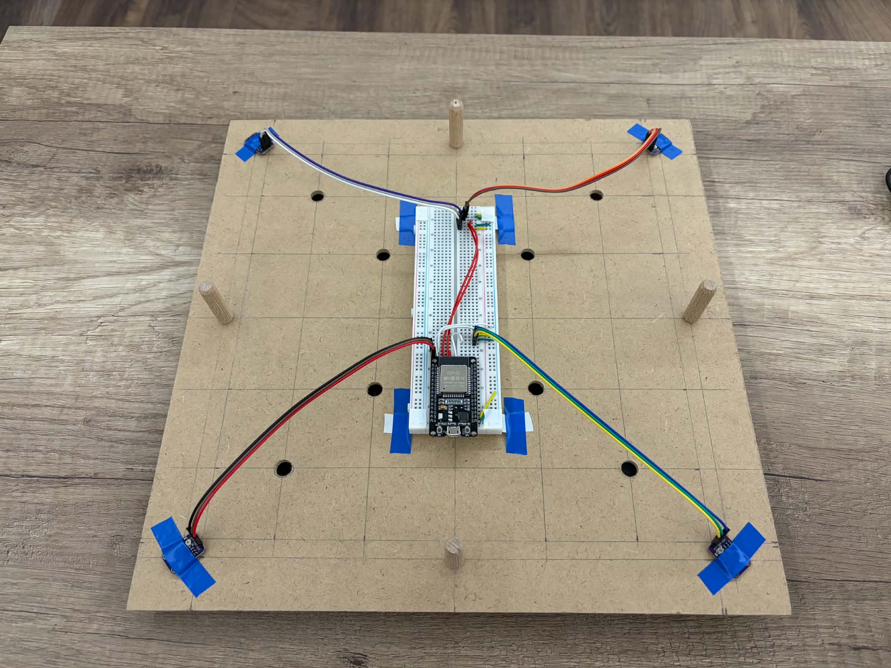
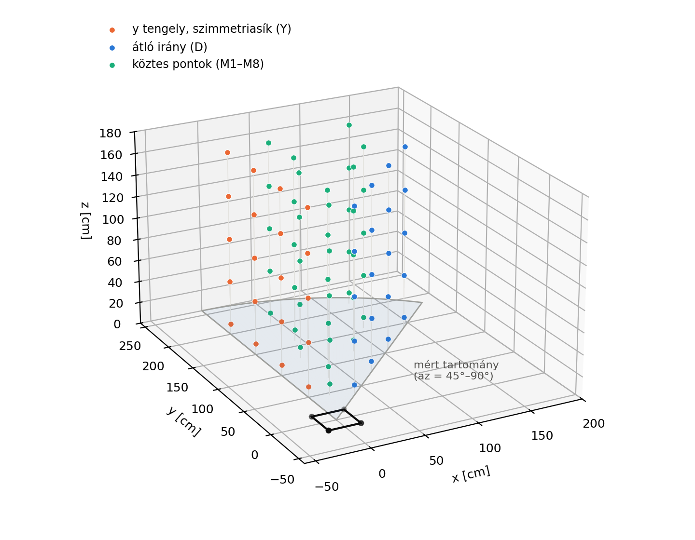
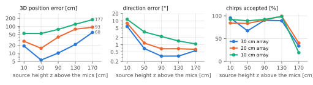
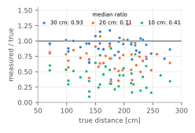
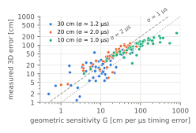

# Négymikrofonos hangforrás-lokalizáció beágyazott rendszeren

Nádas Martin – B85JM5 · Okos Eszközök Laboratórium · 2026. ősz

---

## Kivonat

A félév során egy négy mikrofonból álló, ESP32 mikrovezérlőre épülő hangforrás-lokalizáló rendszert terveztem, építettem és vizsgáltam meg. A jelfeldolgozás teljes egészében a mikrovezérlőn fut. A rendszer először felismeri a hangjelet, majd GCC-PHAT algoritmussal megbecsüli, mennyi idő telik el a hang érkezése között az egyes mikrofonokon. Végül ezekből a késleltetésekből geometriai úton kiszámítja a hangforrás irányát és helyét.

A mikrofon-rendszert három különböző elrendezésben vizsgáltam: a mikrofonok egy 10, 20, illetve 30 cm oldalhosszúságú négyzet sarkaiban álltak. A pontosságot elrendezésenként 80 ismert térbeli ponton, összesen több mint 5000 hangjellel mértem ki.

A mérések szerint az irány minden elrendezésben 3 m távolságig jól becsülhető: a 30 cm-es elrendezéssel 0,3–0,7°, a 10 cm-essel 1–3,4° a jellemző hiba. A teljes 3D pozíció viszont csak a 30 cm-es elrendezéssel, alacsony és közepes elevációnál használható megfelelő pontossággal.

A 3D pozícióhibát egy egyszerű geometriai hibamodell írja le: 3D hiba ≈ G · σ. Itt G a geometriai érzékenység, amely megadja, hogy egy adott forráshelyzetben és mikrofonelrendezésben 1 µs időzítési hiba hány centiméter helyzethibát okoz. σ az effektív időzítési hiba, vagyis az a bizonytalanság, amellyel a teljes mérőrendszer (az elektronika zaja, a visszaverődések és a referenciapozíciók pontatlansága együtt) a mikrofonok érkezési idejét terheli. A mérések alapján σ ≈ 1–2 µs. A modell a vizsgált környezetben a Fraunhofer-távolságnál pontosabban jelöli ki, meddig ad a rendszer használható térbeli pozíciót, és honnan marad megbízható csak az irány.

## 1. Bevezetés és célkitűzés

A hangforrás-lokalizáció (sound source localization, SSL) célja egy hangot kibocsátó objektum helyének meghatározása mikrofonok jeleiből. Jellemző alkalmazási területei a beszélőkövetés, lokalizáció és védelmi iparban pedig a drónok akusztikus észlelése [2, 12]. A kis költségű, beágyazott megvalósítás azért érdekes, mert a módszer alapvető korlátai itt élesen jelentkeznek. A mikrofonok egymáshoz közel vannak, a mintavételezés felbontása korlátozott, és a számítási kapacitás is alacsony. Ezért érdemes megvizsgálni, mire képes egy ilyen rendszer, és hol vannak a határai.

A munka központi kérdése az, hogy egy síkbeli, négyzetes mikrofon-rendszer mérete és a hangforrás térbeli helyzete hogyan határozza meg a lokalizáció pontosságát. Konkrétabban: meddig ad a rendszer megbízható térbeli pozíciót, és honnan kezdve marad használható csak az irány? Ezt a határt a továbbiakban operatív közel-/távoltéri határnak nevezem. Elméleti viszonyítási alapként a Fraunhofer-távolság (2D²/λ) szolgál, amely azt jellemzi, mekkora távolságtól tekinthető a beérkező hullámfront síknak [11].

Az algoritmikus megközelítésnél szándékosan klasszikus és determinisztikus megoldást választottam. A mikrofonpárok közötti érkezésiidő-különbségeket (time difference of arrival, TDOA) a GCC-PHAT algoritmus becsli, a pozíciót ezekből geometriai illesztés adja. A hangforrás ismert, megismételhető tesztjelet bocsát ki.

A féléves munka az irodalomkutatással kezdődött, amely a módszer kiválasztását alapozta meg. Ezt a hardver kiválasztása és összeszerelése követte, majd a mikrovezérlő firmware-jének és a laptopon futó mérőszoftvernek a fejlesztése. Egy előzetes méréssorozattal kiválasztottam a legalkalmasabb tesztjelet, ezután következett a fő mérési kampány a három mikrofonelrendezéssel. A munkát az eredmények kiértékelése és egy élő demonstrációs alkalmazás zárta. A dokumentum ezt a sorrendet követi.

## 2. Irodalmi háttér és a módszer kiválasztása

A több mikrofonos hangforrás-lokalizáció módszerei három fő csoportba sorolhatók [2].

A **TDOA-alapú** eljárások először azt becsülik meg, mennyivel később érkezik a hang az egyik mikrofonhoz, mint a másikhoz. Ezekből a késleltetésekből geometriai úton számítják ki a forrás helyét. A késleltetésbecslés klasszikus eszköze az általánosított keresztkorreláció (GCC), amelynek PHAT-súlyozása a két jel keresztspektrumából csak a fázist tartja meg [1]. Ezáltal a korrelációs csúcs éles lesz, és a módszer kevésbé érzékeny a terem rezonanciáira, ami zárt térben döntő előny [3].

A **nyalábformálásos** (beamforming) eljárások, például az SRP-PHAT [5], a tér sok jelölt pontjára kiszámítják, mekkora jelet „hallana” a mikrofon-rendszer, ha arra a pontra fókuszálna, és a legerősebb választ keresik. Ez robusztusabb, de a számításigénye a jelölt pontok számával arányosan nő [7].

Az **altérmódszerek**, például a MUSIC [4], a mikrofonjelek kovarianciamátrixának sajátérték-felbontásán alapulnak. Nagy felbontást adnak, de keskenysávú jelmodellt, sok mikrofont és frekvenciasávonként külön mátrixműveleteket igényelnek.

Az utóbbi években megjelentek a **gépi tanulásos** megoldások is [6]. Ezek jó eredményt adnak, de nagy tanítóadatbázist igényelnek, és a működésük nehezen értelmezhető.

A választásnál két szempont döntött. Az egyik, hogy a rendszer egy mikrovezérlőn, valós időben fusson. A másik, hogy minden hibaforrás visszavezethető legyen egy fizikai modellre, mert a munka célja éppen a pontosság korlátainak megértése. Ezért a GCC-PHAT késleltetésbecslést és az erre épülő legkisebb négyzetes geometriai illesztést választottam. A GCC-PHAT számítási igénye detektálásonként néhány FFT, működése determinisztikus, és nincs hangolandó paramétere. A kimenete, a hat mikrofonpár késleltetése, közvetlenül összevethető azzal, amit a geometria egy adott forráshelyzetre előre jelez.

A GCC-PHAT csak akkor alkalmazható, ha tudjuk, hogy a folyamatosan rögzített hangban mikor szólt a tesztjel. Ezt a feladatot illesztett szűrő oldja meg [8]. Az illesztett szűrő az ismert tesztjelet mintaként végigcsúsztatja a felvételen, és minden időpontban kiszámítja, mennyire hasonlít rá a felvétel. Ahol a tesztjel valóban jelen van, ott a hasonlóság éles csúcsot ad.

### Ipari példa: az akusztikus kamera

A több mikrofonos lokalizáció legismertebb ipari alkalmazása az akusztikus kamera (sound camera). A készülék egy síkbeli mikrofon-rendszert és egy videokamerát egyesít. A mikrofonok jeleiből nyalábformálással kiszámítja, milyen erős hang érkezik a kép egyes pontjainak irányából, és az eredményt színes hangtérképként a videoképre vetíti. A kézi készülékek néhány tucat, a nagyobb rendszerek több száz MEMS-mikrofonnal dolgoznak; a Teledyne FLIR Si124 kézi kamerában például 124 mikrofon van [13]. A mikrofonok jellemzően spirál alakban helyezkednek el, mert a szabálytalan elrendezés elnyomja a hamis mellékcsúcsokat.

Tipikus felhasználási területei a sűrített levegő- és gázszivárgások felderítése, a villamos berendezések részkisüléseinek keresése, valamint gépek és járművek zajforrásainak azonosítása.

Az akusztikus kamera ugyanarra a fizikai elvre épül, mint ez a munka: a hang különböző időpontokban éri el az egyes mikrofonokat. Lényeges különbség, hogy a kamera a forrást a képsíkon, vagyis irányként jeleníti meg, távolságot nem mér. Ez összhangban van a 7. fejezet eredményével, amely szerint egy síkbeli mikrofon-rendszer az irányt sokkal megbízhatóbban határozza meg, mint a távolságot.

Az 1. ábra egy kézi akusztikus kamerát mutat. A bal oldali készülék elején a furatok mögött ülnek a mikrofonok, spirálkarok mentén elrendezve. A jobb oldali kijelzőn a mérés eredménye látszik: a hangtérkép egy alállomás videoképére vetítve jelöli a részkisülés helyét. A sok mikrofon és a nagy kiterjedés éles, kevés mellékcsúccsal terhelt hangtérképet ad, és több forrás egyidejű szétválasztását is lehetővé teszi. Négy mikrofonnal, mint ebben a munkában, ezzel szemben csak egyetlen, domináns forrás iránya becsülhető megbízhatóan.

*1. ábra. Teledyne FLIR Si2 sorozatú kézi akusztikus kamera: elöl a mikrofonokat takaró furatmező, hátul a kijelző a videoképre vetített hangtérképpel (forrás: Teledyne FLIR termékfotó).*

## 3. Hardver

### 3.1 Követelmények

A hardverkövetelményeket a kívánt szögfelbontásból vezettem le. Ha két mikrofon egymástól a távolságra van, a forrás 1°-os elmozdulása Δt = a·sin(1°)/c-vel változtatja meg a köztük mért késleltetést. Ez 30 cm-es távolságnál 15 µs, 10 cm-esnél 5 µs.

A 3–12 kHz-es tesztjelhez (5. fejezet) legalább 24 kHz-es csatornánkénti mintavétel szükséges. A szabványos 44,1 kHz-es mintavételnél egy minta 22,7 µs, vagyis a szükséges időfelbontás csak a mintaközök közötti interpolációval érhető el. Ehhez a négy csatornát közös órával, rögzített fázissal kell mintavételezni, különben a csatornák közötti időbizonytalanság közvetlenül a késleltetésbe kerül.

A 30 cm-es négyzet átlója 42,4 cm, így két mikrofon között legfeljebb 1,24 ms lehet a késleltetés. A feldolgozási ablaknak ezt le kell fednie.

### 3.2 Mikrovezérlő: ESP32

A feldolgozóegység egy ESP32 fejlesztőpanel (ESP32-DevKit).

A döntő érv a beépített analóg-digitális átalakító (ADC) folyamatos, DMA-alapú üzemmódja. Ebben a hardver a processzor terhelése nélkül, egyenletes ütemben mintavételez több csatornát. A gyártói dokumentáció szerint az összesített mintavételi frekvencia elérheti a 2 MS/s-ot [10]. Ez bőven elég arra, hogy a négy mikrofont csatornánként 44,1 kHz-en, ráadásul négyszeres túlmintavételezéssel olvassam. Az összesített 705,6 kS/s-os ütemben minden kimeneti minta négy ADC-olvasás átlaga, ami körülbelül 6 dB-lel csökkenti az átalakító zaját.

A második érv a számítási kapacitás: az ESP32-ben két 240 MHz-es processzormag dolgozik lebegőpontos egységgel, és 520 kB belső memória áll rendelkezésre. Így a teljes jelfeldolgozás a panelen futtatható: az egyik mag folyamatosan mintavételez, a másik a feldolgozást végzi. Harmadrészt a panel olcsó, és USB-n egyszerűen programozható.

Az alternatívák közül az egyszerűbb, 8 bites mikrovezérlők ADC-je csak néhány tíz kHz összesített mintavételre képes, és memóriájuk sem elég egy 4096 pontos FFT-hez. Az egykártyás számítógépeknek (pl. Raspberry Pi) nincs analóg bemenetük, így külső, többcsatornás hangkártyát igényelnének.

Az ESP32 ADC-jének ismert korlátja, hogy egyetlen átalakítóval dolgozik, amely a csatornák között kapcsolgat. A négy mikrofont tehát nem egyszerre, hanem egymás után mintavételezi. Ez a szomszédos csatornák között állandó, 1,417 µs-os eltolást okoz, amelyet a szoftver minden késleltetésben korrigál. Mivel az eltolás állandó, a korrekció pontos.

### 3.3 Mikrofonok és mechanika

Érzékelőként négy, erősítővel ellátott elektret mikrofonmodult használtam. A modulok analóg kimenete közvetlenül az ESP32 ADC1 bemeneteire csatlakozik (GPIO34, 35, 32 és 33). Az ADC2 azért nem használható, mert a DMA-mód csak az ADC1-en érhető el. A bemeneti tartomány 0–3,1 V, a csendes nyugalmi szint kb. 1940 egység, vagyis a 12 bites tartomány közepén van.

*2. ábra. A tartólemez felülről, az x és y tengellyel és a mikrofonhelyek koordinátáival: (±5, ±5), (±10, ±10), (±15, ±15) cm.*

*3. ábra. A mikrofon-rendszer alulról, 30 cm-es elrendezésben. Középen az ESP32 fejlesztőpanel próbapanelen, a sarkokban a négy mikrofonmodul, a lemezen a koordináta-rács.*

A négy mikrofon a legkisebb szám, amely a térbeli helyzethez elegendő információt ad. Négy érkezési időből három független késleltetés képezhető, ez éppen elég a három ismeretlen (x, y, z) meghatározásához. Mivel a mikrofonok egy síkban vannak, a mérés nem tudja megkülönböztetni a sík feletti forrást a tükörképétől a sík alatt. Ezt a z ≥ 0 feltétel oldja fel: a mikrofon-rendszer a padlón áll, így a vizsgálat csak a mikrofonsík feletti forrásokra terjed ki.

A négyzet szimmetriájának ára, hogy a szimmetriasíkokban (x = 0 és y = 0) a forrás távolsága nem határozható meg (7.6. fejezet). Ezt a mérési tervben tudatosan ellenőrzésként használtam.

Az origó a négyzet középpontja a mikrofonok síkjában, z felfelé mutat. A mikrofonok helye h = a/2 jelöléssel:

- Mic1: (−h, +h);
- Mic2: (+h, +h);
- Mic3: (+h, −h);
- Mic4: (−h, −h).

A mikrofonsík 4 cm-re van a padló felett. A tartólemezen a mikrofonok a négyzet átlói mentén áthelyezhetők, így ugyanazzal a lemezzel, változatlan középponttal és tájolással 10, 20 és 30 cm-es elrendezés állítható össze.

### 3.4 Hangforrás

Hangforrásként egy okostelefont (böngészőben futó lejátszó, 48 kHz) használtam. Ennek három oka volt:

1. A jel digitálisan pontosan reprodukálható.
2. A laptop távolról vezérelheti, így a mérés kézi beavatkozás nélkül automatizálható.
3. A telefon szabadon elhelyezhető a térben.

A telefon fő (alsó) hangszórója a sztereó jel bal csatornáját szólaltatja meg. Ezt csatornateszttel állapítottam meg, és minden mérés csak ezt a hangszórót használta. A forrás helyének referenciapontja a hangszórónyílás.

## 4. Szoftver

### 4.1 Áttekintés

A rendszer szoftvere három részből áll:

- a mikrovezérlő firmware-je (C++, Arduino/ESP-IDF keretrendszer);
- a laptopon futó Python-eszközök a vezérléshez, a mérések lebonyolításához és a kiértékeléshez;
- a telefon böngészőjében futó hanglejátszó oldal.

A jelfeldolgozás teljes egészében a mikrovezérlőn történik. A laptop csak vezérel és naplóz: USB soros vonalon detektálásonként egy rövid, szöveges (JSON) eredménysort kap.

A firmware a két processzormag között osztja meg a munkát. Az egyik mag kizárólag a mintavételezéssel foglalkozik, így az soha nem akad meg. A másik mag végzi a feldolgozást, amely öt lépésből áll: a tesztjel felismerése, a késleltetések becslése, a késleltetések ellenőrzése, a helymeghatározás és az eredmény kiküldése. A következő alfejezetek ezeket a lépéseket a feldolgozás sorrendjében mutatják be.

### 4.2 Mintavételezés és gyűrűs puffer

Az ADC DMA-módban a négy csatornát folyamatosan, felváltva olvassa, és az eredményt blokkokban adja át. A mintavételező mag minden csatornán négy egymást követő olvasást átlagol, így csatornánként 44,1 kHz-es, zajszegényebb jel áll elő.

A mintákat egy gyűrűs pufferbe írja, amely mindig a legutóbbi kb. 280 ms hangot tárolja. Amíg a másik mag egy detektált jelet dolgoz fel, a mintavétel zavartalanul folyik tovább, és a puffer elég hosszú ahhoz, hogy közben semmi ne vesszen el.

### 4.3 A tesztjel felismerése

A feldolgozó mag a beérkező hangot blokkonként vizsgálja, és illesztett szűrővel keresi benne a tesztjelet (2. fejezet). Ehhez a négy mikrofon jelének összegét veszi, és ezt korrelálja az ismert tesztjellel. A számítást a frekvenciatartományban végzi, 4096 pontos FFT-vel és átlapolt blokkokkal (overlap-save), mert így a hosszú korreláció gyorsan kiszámítható.

A szűrő kimenete akkor jelez tesztjelet, ha a pillanatnyi érték a kimenet mediánjának 12-szeresét meghaladja. A medián a háttérzaj szintjét követi, így a küszöb a környezet zajosságához alkalmazkodik. Egy detektálás után rövid holtidő következik, hogy ugyanannak a jelnek a visszhangja ne okozzon újabb detektálást.

Detektáláskor a firmware a gyűrűs pufferből kimásolja a jel körüli ablakot, minden mikrofonra külön. Az ablak 3 ms-mal a jel kezdete előtt indul, és a tesztjel teljes hosszát, valamint a lehetséges legnagyobb késleltetést is lefedi.

Az első, egyszerű hangerőküszöbös detektor nem működött, mert a tesztjel mintánként a háttérzaj alatt marad. Ez indokolta az illesztett szűrő használatát.

### 4.4 Késleltetésbecslés GCC-PHAT-tal: a feldolgozás lényege

A rendszer pontosságát alapvetően ez a lépés határozza meg. A feladat az, hogy mind a hat mikrofonpárra (1–2, 1–3, 1–4, 2–3, 2–4, 3–4) megmondjuk, mennyivel később érkezett a hang az egyik mikrofonhoz, mint a másikhoz.

Először a firmware mind a négy mikrofon ablakát FFT-vel a frekvenciatartományba viszi. A további számításhoz csak a tesztjel sávjába eső frekvenciákat használja (kb. 2,4–13,5 kHz), mert a sávon kívül csak zaj van.

Ezután minden mikrofonpárra kiszámítja a két jel keresztspektrumát. Ez frekvenciánként megmutatja, mekkora fáziskülönbséggel érkezett a hang a két mikrofonhoz. Egy t késleltetés minden frekvencián olyan fáziskülönbséget okoz, amely a frekvenciával arányosan nő.

A PHAT-súlyozás a keresztspektrum minden frekvenciakomponensét egységnyi nagyságúra normálja, vagyis csak a fázisinformációt tartja meg. Ennek az a haszna, hogy minden frekvencia egyenlő súllyal szól bele az eredménybe. Egy erős teremrezonancia vagy a hangszóró egyenetlen frekvenciamenete így nem tudja eltorzítani a becslést.

A normált keresztspektrum inverz FFT-je a két jel korrelációját adja a késleltetés függvényében. Ennek ott van a csúcsa, ahol a két jel a legjobban fedi egymást. A firmware a csúcsot a fizikailag lehetséges ±1,5 ms-os tartományban keresi. Két mikrofonpár számítása egyetlen komplex FFT-be összevonható, ami a munkát felezi.

Az egész mintára kerekített csúcshely önmagában 22,7 µs-os lépésekben adná meg a késleltetést, ami a szükséges pontosságnál durvább. Ezért a firmware a csúcs környezetében a korrelációt a minta 1/16-ának megfelelő (1,4 µs-os) lépésekben újra kiértékeli, közvetlenül a sávkorlátozott spektrumból, majd a legjobb három értékre parabolát illeszt. Így a késleltetés a mintaidő törtrészének pontosságával adódik.

A csúcs magassága egyben minőségi mérőszám is (q). Tökéletes egyezésnél minden frekvenciakomponens azonos fázisban adódik össze, és q = 1. Zaj vagy visszaverődés esetén a komponensek részben kioltják egymást, és q kisebb lesz.

Végül a firmware minden késleltetésből levonja a csatornák egymás utáni mintavételéből eredő, ismert 1,417 µs-os eltolást.

### 4.5 A késleltetések ellenőrzése

A hat párkésleltetés nem független egymástól, mert mind ugyanabból a négy érkezési időből származik. Például az 1–2 és a 2–3 pár késleltetésének összege meg kell egyezzen az 1–3 pár késleltetésével. A firmware a legkisebb négyzetek módszerével megkeresi azt a négy érkezési időt, amely a hat mért értékkel a legjobban egyezik. Az ettől való átlagos eltérés (misfit) azt mutatja, mennyire ellentmondásosak a mérések.

Ha például az egyik mikrofonpár korrelációja egy visszaverődésre ült rá, a hat érték nem lesz egymással összhangban, és a misfit megnő. A detektálást a rendszer akkor fogadja el, ha a misfit 10 µs alatt marad, és mind a hat pár minőségi mérőszáma (q) meghaladja a 0,2-et.

### 4.6 Helymeghatározás

A forrás helyét az a pont adja, ahonnan érkezve a hang éppen a mért késleltetéseket okozná. Ezt a firmware két lépésben keresi meg.

Először egy durva rácson (14 távolság × 36 azimut × 15 eleváció) minden pontra kiszámítja a várható késleltetéseket, és kiválasztja a mérthez legközelebbi öt jelöltet. Ezekből indítva Levenberg–Marquardt-féle nemlineáris legkisebb négyzetes illesztéssel [9] finomítja a helyet, a z ≥ 0 feltétel mellett. A durva rács azt biztosítja, hogy az illesztés ne ragadjon be egy rossz helyi minimumba.

Az irányt a firmware ettől függetlenül is kiszámítja, egy egyszerűbb, távoltéri modellel. Ha a forrás messze van, a hullámfront a mikrofonoknál közel sík. Ez az iránybecslés nem igényel iterációt, és nem függ a távolságtól, amelyet a rendszer sokkal bizonytalanabbul határoz meg (7. fejezet).

### 4.7 Kimenet, vezérlés, ellenőrizhetőség

Egy detektálás teljes feldolgozása kb. 72 ms. Az eredmény egyetlen JSON-sorban megy ki, amely tartalmazza:

- a négy érkezési időt;
- a minőségi mérőszámokat;
- a becsült helyet és irányt;
- a vett jelszintet.

A firmware soros parancsokkal konfigurálható. Futás közben beállítható a mikrofonelrendezés mérete, a hőmérséklet (ebből számolja a hangsebességet), a detektálási küszöb, a holtidő, és a tesztjel mintája is feltölthető. Így a jelválasztás újrafordítás nélkül elvégezhető. A beállítások a flash-memóriában megmaradnak.

### 4.8 Laptopoldali eszközök

A laptopon futó Python-szoftver kezeli a soros kapcsolatot, és egy kis webszerveren keresztül vezérli a telefont. A telefon böngészője a laptop által kiszolgált oldalt nyitja meg, és onnan kapja a lejátszási parancsokat. A laptop ugyanazt a tesztjelet tölti fel mintaként az ESP32-re, amelyet a telefonnal lejátszat.

Erre épül két mérőprogram:

- A **jelösszehasonlító mérőpad** különböző jeleket és hangerőket játszat le, a detektálásokat időzítésük alapján hozzárendeli az egyes lejátszásokhoz, és a valós pozícióhoz viszonyítva kiértékeli őket.
- A **sorozatmérő program** egy előre megadott ponttervet jár végig. A mérést a telefonról lehet léptetni (mérés, előző pont újramérése, kihagyás), és minden pont után a telefon azonnal kijelzi az eredményt.

A kiértékelő szkriptek a mért adatokból táblázatokat és ábrákat készítenek. Az egész adathalmaz egy önálló, interaktív weboldalon is böngészhető, 3D nézettel és ki-be kapcsolható rétegekkel.

### 4.9 Élő demonstrációs alkalmazás

A rendszer képességét egy élő alkalmazás mutatja be. A telefon folyamatosan, 0,25 s-onként játssza a tesztjelet, a böngészőben megnyitott oldal pedig valós időben mutatja a forrás helyét felül- és oldalnézetben.

Az alkalmazás a kiértékelés fő eredményére épül: az irány megbízható, a szabadon becsült távolság nem. Ezért a pozíciót nem a 3D illesztésből veszi. Ehelyett a mért irányt egy ismert magasságú vízszintes síkkal metszi el; a sík magassága alapértelmezésként 1 m, és a felhasználó állíthatja.

### 4.10 Forráskód

A rendszer teljes forráskódja (firmware, laptopoldali programok, élő alkalmazás), a mérési adatok és a kiértékelő szkriptek GitHub-tárolóban érhetők el: https://github.com/nadasmartin/Sound_Source_Localization

## 5. A tesztjel kiválasztása

A különböző mikrofonelrendezések csak akkor hasonlíthatók össze, ha a mérés minden más körülménye azonos. A tesztjel ezért a fő mérési sorozatban nem változhatott. Ugyanakkor a jel megválasztása önmagában is befolyásolja a pontosságot: a sávszélesség, a frekvenciatartomány és a jel hossza mind hatással van a késleltetésbecslésre. Ezért a fő sorozat előtt szisztematikus összehasonlítással kiválasztottam azt a jelet, amellyel a késleltetésbecslés a legpontosabb és a legjobban ismételhető, és ezt a továbbiakban rögzítettem.

Az összehasonlítást a 30 cm-es elrendezéssel, a mikrofon-rendszer körül négy pozícióban (P1–P4) végeztem. A pozíciók mind a négy negyedben, kb. 60 cm távolságban és 45° elevációban voltak. Minden pozícióban 25 jel szólt véletlen sorrendben, mindegyik négy hangerőn (0, −10, −20 és −30 dB) és három ismétléssel. A jelek között 14 különböző sávú, 50 ms-os lineáris chirp, rövidebb (10–35 ms-os) chirpek, logaritmikus chirpek és sávkorlátozott zajimpulzusok szerepeltek.

A jelek rangsora egyértelmű lett (2. táblázat).

*2. táblázat. A legjobb jelek és két rosszabb jelcsoport, mind a négy pozíción, 0 és −10 dB-en.*

| Jel | Ismételhetőség | Pozícióhiba medián / max |
|---|---|---|
| chirp 3–12 kHz, 50 ms | 0,36–0,44 µs | 3,0–3,5 / 7,8–8,8 cm |
| chirp 4–12 kHz, 50 ms | 0,40–0,58 µs | 3,5–3,7 / 7,5–7,8 cm |
| chirp 5–14 kHz, 50 ms | 0,54–0,75 µs | 3,5 / 5,0–5,2 cm |
| 2 kHz alatt kezdődő sávok | 0,4–1,5 µs | 6–13 / 25–34 cm |
| zajimpulzusok | 0,7–1,4 µs | 3–9 / 9–31 cm |

A választás a **3–12 kHz-es, 50 ms-os lineáris chirpre** esett. Ennek volt a legjobb az ismételhetősége, és minden pozíción, mindkét hangerőn 100 %-ban felismerhető volt.

## 6. A mérési kampány

### 6.1 A mérés célja

A mérési kampány azt vizsgálta, hogyan függ a lokalizáció pontossága a mikrofonelrendezés méretétől és a hangforrás helyzetétől. Ehhez mindhárom elrendezésre ugyanazt a feladatot kellett elvégezni: a hangforrást sok, pontosan ismert térbeli pontba helyezni, és mindegyik pontban összevetni a mért helyet és irányt a valóssal.

A mérésnek elég sűrűnek kellett lennie ahhoz, hogy kirajzolódjon, a tér mely részén ad a rendszer megbízható 3D pozíciót, és hol már csak irányt. Elég kiterjedtnek is kellett lennie, hogy a különböző irányok, távolságok és magasságok hatása szétválasztható legyen.

### 6.2 A mérési pontok kiválasztása

Ideális esetben a mikrofon-rendszer körüli teret minden irányban, egy teljes gömb mentén mérnénk ki. Ez azonban több irány, távolság és magasság kombinációjában olyan sok mérési pontot jelentene, amely elrendezésenként és ésszerű időn belül nem mérhető ki.

A mérési pontok számát a rendszer szimmetriája jelentősen csökkenti.

- **Félgömb.** A mikrofon-rendszer a padlón áll, és a vizsgálat a mikrofonsík feletti forrásokra terjed ki, így elég a sík feletti félgömb.
- **Nyolcad.** A négyzetes elrendezésnek négy tükörszimmetria-síkja van: a két tengely (x = 0, y = 0) és a két átló. Ezek a félgömböt nyolc egybevágó, egymás tükörképét alkotó szeletre osztják. Bármely irányban álló forrás tükrözéssel átvihető egyetlen 45°-os szeletbe, és ott ugyanúgy viselkedik.

Elegendő tehát a félgömb egy nyolcadát, az átló (az = 45°) és az y tengely (az = 90°) közötti szeletet kimérni, és az eredmények tükrözéssel minden irányra kiterjeszthetők.

A szeleten belül 16 vízszintes helyet jelöltem ki (4. ábra):

- négyet a szelet egyik határán, az átló irányában (D-vonal: 50, 100, 150 és 200 cm-re a középponttól);
- négyet a másik határán, az y tengelyen (Y-vonal: ugyanezekben a távolságokban);
- nyolcat a kettő között (M1–M8), amelyek a szelet belsejét fedik le kb. 2,5 m vízszintes távolságig.

Minden helyen öt magasságban mértem: a mikrofonsík felett 10, 50, 90, 130 és 170 cm-rel. Ez elrendezésenként 80 mérési pontot jelent. A forrás távolsága a középponttól 50 és 305 cm, az elevációja 2° és 75° között változik.

Az Y-vonal pontjai a négyzet egyik szimmetriasíkjában fekszenek. Az elmélet szerint itt a forrás távolsága nem határozható meg (8. fejezet), ezért ezek a pontok egyben a modell ellenőrzésére is szolgálnak.

*4. ábra. A 80 mérési pont a térben. A fekete négyzet a 30 cm-es elrendezés mikrofonjait, a kék sáv a padlón a kimért 45°-os szeletet jelöli.*

### 6.3 Lebonyolítás

A mérés minden körülményét rögzítettem, hogy az elrendezések között csak a mikrofonok távolsága változzon:

- tesztjel: 3–12 kHz-es chirp, 50 ms;
- pontonként 20 ismétlés 0,5 s-onként;
- egyetlen, rögzített telefonhangerő;
- 21 °C, ebből 344,0 m/s hangsebesség;
- mindhárom elrendezésnél ugyanaz a firmware.

A helyszín egy kb. 5 × 3 × 3 m-es nappali volt.

A telefon hangszórónyílását a padlóra felrajzolt rács alapján a tervezett pontra helyeztem. A mérést a telefonról léptettem, és minden pont után azonnal láttam az eredményt, így a nyilvánvaló elhelyezési hibákat a helyszínen újra lehetett mérni.

Összesen 254 elhelyezés és 5115 detektált tesztjel keletkezett. A statisztikák a D- és M-pontokra vonatkoznak; az Y-vonal pontjait külön tárgyalom, mert ott a távolság elvileg sem mérhető.

## 7. Eredmények

### 7.1 Áttekintés

A 3. táblázat és az 5. ábra a három elrendezés teljesítményét foglalja össze magasságonként. Minden érték a D- és M-pontok mediánja; egy pont értéke az ott mért 20 jel eredményéből adódik.

*3. táblázat. A 3D pozícióhiba, az irányhiba és az elfogadott jelek aránya a forrás magassága szerint.*

| Magasság | 3D hiba [cm] 30 / 20 / 10 cm | Irányhiba [°] 30 / 20 / 10 cm | Elfogadott jelek [%] 30 / 20 / 10 cm |
|---|---|---|---|
| z = 10 cm | 18,8 / 28,0 / 55,1 | 5,8 / 7,9 / 11,5 | 95 / 84 / 92 |
| z = 50 cm | 5,6 / 15,5 / 54,7 | 0,69 / 1,17 / 3,42 | 67 / 83 / 89 |
| z = 90 cm | 10,3 / 40,2 / 77,4 | 0,33 / 0,68 / 2,20 | 90 / 91 / 92 |
| z = 130 cm | 21,4 / 78,9 / 120,4 | 0,33 / 0,68 / 1,44 | 89 / 99 / 99 |
| z = 170 cm | 59,7 / 93,3 / 177,4 | 0,57 / 0,64 / 1,08 | 34 / 40 / 19 |

*5. ábra. 3D hiba, irányhiba és elfogadási arány a forrás magasságának függvényében, a három elrendezésre.*

A legjobb eredményt a 30 cm-es elrendezés adja z = 50 cm-en, 5,6 cm-es medián 3D hibával. Az egyes jelek ismétlésről ismétlésre átlagosan csak kb. 0,65 µs-mal ingadoznak, ami a 22,7 µs-os mintaidő 1/35-öd része. Ez minden elrendezésre azonos, vagyis az elektronika és a jelfeldolgozás ismételhetősége nem függ a mikrofonok távolságától.

### 7.2 A mikrofon-rendszer helyzetének ellenőrzése

A forráspozíciókat a padlóra rajzolt koordináta-rácsban mértem, a kiértékelés pedig feltételezi, hogy a mikrofonok pontosan a névleges helyükön, ehhez a rácshoz igazítva állnak. Ha a mikrofon-rendszer akár 1°-kal el lenne fordulva a rácshoz képest, minden mért irány 1°-kal eltolódna. Ez a hiba nem a lokalizáló rendszer, hanem az összeállítás pontatlansága lenne.

Ezt a kiértékelés előtt ellenőrizni kellett. A 80 ismert pont lehetővé teszi, hogy az elfordulást magából a mérésből becsüljük: azt az elforgatási szöget keressük, amelynél a mért késleltetések a legjobban egyeznek a valós pozíciókból számolt értékekkel. Az eredmény a 30, 20 és 10 cm-es elrendezésre −0,15°, −0,05° és −0,15° lett. Ez gyakorlatilag nulla, és bőven az összeállítás pontosságán belül van.

A mikrofon-rendszer tehát mindhárom elrendezésben pontosan a rácshoz igazítva állt, annak ellenére, hogy a mikrofonokat az elrendezések között külön kalibráció nélkül helyeztem át. A kiértékelés ezért a névleges geometriát használja, és a bemutatott hibák a lokalizáló rendszer tulajdonságait tükrözik, nem az összeállításét.

### 7.3 Az irány robusztus, a távolság nem

A legfontosabb megfigyelés az irány és a távolság eltérő viselkedése.

z ≥ 50 cm-en a medián irányhiba a 30 cm-es elrendezésnél 0,3–0,7°, a 20 cm-esnél 0,6–1,2°, a 10 cm-esnél 1,1–3,4°. Ez 3 m távolságig sem nő számottevően. Az Y-vonalon, ahol a távolság egyáltalán nem határozható meg, az irány ugyanilyen pontos.

A 3D hiba ezzel szemben gyorsan nő, ahogy csökken a mikrofonok távolsága és nő a forrás magassága.

A különbség oka a síkbeli elrendezés geometriájában rejlik. Az irányt az határozza meg, hogy melyik mikrofonhoz ér előbb a hang; ez a késleltetések nagy, elsőrendű része. A távolságot csak az árulja el, hogy a közeli forrás hullámfrontja gömb alakú, nem sík. Ez a görbület a késleltetéseken csak kis, másodrendű eltérést okoz, amelyet a mérési hiba könnyen elfed. Ezt a 8. fejezet részletesen tárgyalja.

A mért pontok jellegzetesen a forrás felé mutató egyenes mentén szóródnak: az irány jó, de a mért távolság a valósnál rövidebb. A mért és a valós távolság arányának mediánja 0,93 (30 cm), 0,71 (20 cm) és 0,41 (10 cm) (6. ábra). A rövidülés okát nem sikerült egyértelműen azonosítani. Lehetséges magyarázat a megoldó torzítása gyenge görbületnél, a padló- vagy mennyezetreflexió, illetve a hangszóró elhelyezési hibája.

*6. ábra. A mért és a valós távolság aránya (z ≥ 50 cm, D- és M-pontok).*

### 7.4 Elutasított jelek és helyfüggő meghibásodás

Az elfogadott jelek aránya a három elrendezésnél hasonló, és ugyanott esik vissza: z = 170 cm-en és a legtávolabbi pontokon, 0–40 %-ra. A meghibásodás tehát a forrás helyétől függ, nem az elrendezés méretétől.

A vett jelszint mindenhol kb. −40 dB volt, így nem a hangerő hiányzik. Az elutasításokat az okozza, hogy a GCC-PHAT minőségi mérőszáma (q) a 0,2-es küszöb körül van, és hogy a hat késleltetés ellentmond egymásnak (misfit 15–350 µs). Mindkettő a visszaverődésekre utal.

Figyelemre méltó, hogy az elutasított jelekből számolt irány is használható. Ezeken a pontokon az összes detektált jelre vett medián irányhiba 2,5° (30 cm), 4,0° (20 cm) és 7,8° (10 cm). A rendszer tehát akkor is tudja az irányt, amikor egymással összhangban lévő késleltetéseket, és így térbeli pozíciót, már nem tud adni.

### 7.5 Különleges geometriák

**Szimmetriasík.** Az Y-vonal (x = 0) mind a 20 pontjánál a távolság hibája +300 és +740 cm között volt: a helymeghatározás a keresési tartomány határáig futott. Ez igazolja az elméleti előrejelzést. A szimmetriasíkban fekvő forrás hangja a sík két oldalán lévő mikrofonpárokhoz páronként egyszerre érkezik, így a hat késleltetésből kevesebb független információ marad, mint ami a távolsághoz kellene (8. fejezet). Az irány közben itt is pontos.

Négyzetes elrendezés körül az irányok jelentős része esik egy ilyen sík közelébe, ezért a jelenség a gyakorlatban is számottevő.

**Súroló beesés.** z = 10 cm-en az irányhiba minden elrendezésnél 6–12°. A forrás ilyenkor szinte a mikrofonok síkjában van. Mivel a mikrofonsík csak 4 cm-re van a padló felett, a padlóról visszavert hang szinte a közvetlen hanggal együtt érkezik, és torzítja a korrelációt. A hiba mindhárom elrendezésnél hasonló, ami akusztikai, nem geometriai eredetre utal.

### 7.6 Az operatív közel-/távoltéri határ

A rendszer alkalmasságának összefoglalására minden mérési pontot három képességosztály egyikébe soroltam:

- **3D pozíció:** a pont 3D hibája legfeljebb 20 cm, és a jelek legalább fele elfogadott;
- **csak irány:** a 3D hiba nagyobb, de az irányhiba legfeljebb 3°, ugyanilyen elfogadási arány mellett;
- **megbízhatatlan:** minden más pont.

Az elméleti viszonyítási alap a Fraunhofer-távolság, R_F = 2D²/λ [11]. Ennél közelebb a hullámfront görbülete még kimutatható, így elvileg a távolság is mérhető; ennél távolabb a hullámfront gyakorlatilag sík, és csak az irány határozható meg. A képletben λ a hang hullámhossza; a tesztjel 7,5 kHz-es sávközepén ez 4,6 cm.

D a mikrofon-rendszer legnagyobb kiterjedése, vagyis a két legtávolabbi mikrofon távolsága. Négyzetes elrendezésnél ez a négyzet átlója (30 cm-es oldalhossznál 42,4 cm).

*4. táblázat. A mérési pontok képességosztályai (D- és M-pontok, elrendezésenként 59–60) és az elméleti Fraunhofer-távolság.*

| Elrendezés | 3D pozíció | Csak irány | Megbízhatatlan | Fraunhofer-távolság |
|---|---|---|---|---|
| 30 cm | 21 | 12 | 26 | 787 cm |
| 20 cm | 8 | 30 | 22 | 350 cm |
| 10 cm | 0 | 28 | 32 | 87 cm |

A 10 cm-es elrendezésnél a mérés egyezik az elmélettel. Szinte minden mérési pont az elméleti 87 cm-es határnál távolabb van, és egyetlen pont sem ad használható 3D pozíciót.

A 30 és a 20 cm-es elrendezésnél a vizsgált környezetben ez az elméleti határ nem teljesül, a használható tartomány annál rövidebb. A 30 cm-es elrendezésnél minden mérési pont az elméleti határon belül van, a 3D pozíció mégis csak z = 50 és 90 cm-es magasságon, kb. 2–2,5 m-ig használható. Meredekebb vagy távolabbi forrásnál csak az irány megbízható. A 20 cm-es elrendezés is jóval az elméleti 350 cm-es határ előtt elveszíti a térbeli pozíciót.

A Fraunhofer-távolság ideális, visszaverődésmentes teret feltételez. A valós szobában a padló közelsége, a falak és a bútorok visszaverődései a mérést terhelik, és ez a kis, görbületből származó távolságinformációt hamarabb elfedi, mint az elmélet szerint. A határ emellett az iránytól is függ: meredeken felülről érkező hang és a szimmetriasíkok közelében a távolság nehezebben mérhető. Ezt az iránnyal is számoló hibamodellt mutatja be a 8. fejezet.

## 8. A négymikrofonos elrendezés geometriai hibamodellje

A helyzetet a mért késleltetésekből számítjuk, így azok kis hibája a helyre is átterjed. Ennek mértékét a **geometriai érzékenység, G** (cm/µs) írja le: megadja, hány centiméterrel lesz bizonytalan a forrás távolsága, ha minden mikrofon érkezési ideje egymástól függetlenül 1 µs-mal pontatlan. G csak a forrás és a mikrofonok egymáshoz viszonyított helyzetétől függ, így minden pontra előre kiszámítható. Értékét a modell linearizálásával kapjuk: abból, hogy a forrás kis elmozdulására hogyan változnak a késleltetések. Ahol alig változnak, ott a kis időzítési hiba nagy helyzethibát okoz.

G három tényezőtől függ:

- **A forrás és a mikrofonok távolságától.** A távolságot csak a hullámfront görbülete hordozza, ezért közelítőleg G ∝ r²/a², ahol r a forrás távolsága, a a négyzet oldalhossza. Kétszeres távolság négyszeres, harmadakkora elrendezés kilencszeres hibát okoz. Az irányhiba csak 1/a szerint nő, ezért marad az irány a kis elrendezésnél is használható.
- **Az elevációtól.** A mikrofonok felett álló forrás hangja mind a négy mikrofonhoz közel egyszerre ér, így a késleltetések alig függnek a távolságtól, és G nagy.
- **A szimmetriasíkoktól.** A szimmetriasíkban (pl. x = 0) a mikrofonok páronként azonos távolságra vannak a forrástól. A távolság ezért elvileg sem mérhető, G végtelen, amit az Y-vonal mérése igazolt (7.5. fejezet).

Ha minden pontban elosztjuk a mért 3D hibát az ott számított G-vel, megkapjuk az **effektív időzítési hibát, σ**-t. Ez a mérőrendszer összes hibaforrását magában foglalja: a zajt, a visszaverődéseket és az elhelyezés pontatlanságát. A mérések szerint σ közel állandó: 1,2 µs (30 cm), 2,0 µs (20 cm) és 1,0 µs (10 cm), miközben maga a 3D hiba két nagyságrendet fog át (7. ábra). σ kétszer-háromszor nagyobb a jelek 0,65 µs-os ingadozásánál, vagyis a pontosságot nem a véletlen zaj korlátozza, hanem helyfüggő, állandó jellegű hibák. Ezért több ismétlés átlagolása sem javítana érdemben.

*7. ábra. A mért 3D hiba a geometriai érzékenység függvényében, mindhárom elrendezés minden pontjára. A pontozott és a szaggatott vonal a σ = 1, illetve 2 µs-hoz tartozó előrejelzés.*

A rendszer pontossága így egyetlen összefüggéssel leírható:

  **3D hiba ≈ G · σ, ahol σ ≈ 1–2 µs.**

Ezzel bármely forráshelyzetre és elrendezésre mérés nélkül megbecsülhető a várható pontosság. Ha például legfeljebb 20 cm hibát engedünk meg, és σ = 1,5 µs, a 3D pozíció ott használható, ahol G ≲ 13 cm/µs. A Fraunhofer-távolsággal szemben ez a határ az elevációt és a szimmetriasíkokat is figyelembe veszi.

## 9. Következtetések

A rendszer működik, és a pontosságának korlátja geometriai, nem elektronikai. A késleltetésbecslés 0,65 µs-os ismételhetősége egy olcsó mikrovezérlő 12 bites, csatornák között kapcsolgató ADC-jétől kiváló eredmény. Ezt a DMA-alapú mintavétel, a túlmintavételezés, az illesztett szűrős felismerés és a GCC-PHAT mintaközi interpolációja együtt teszi lehetővé. A helyzethibát a mikrofonok elrendezése erősíti fel, és a geometriai érzékenység pontosan megmondja, mennyire.

A munka központi kérdésére a válasz a következő:

- Teljes 3D pozícióhoz legalább 30 cm-es elrendezés szükséges, és ez is csak alacsony–közepes elevációnál, kb. 2,5 m-ig ad 20 cm-nél kisebb hibát.
- A 20 cm-es elrendezés csak közeli, alacsonyan fekvő forrásra alkalmas.
- A 10 cm-es elrendezés tisztán irányérzékelőként működik.
- Az irány minden elrendezésben, 3 m-ig, a szimmetriasíkban és az elutasított jelekből is megbízható. Ezt használja ki az élő demonstrációs alkalmazás: ismert magasságú forrás esetén az irányból néhány centiméteres pontosságú helyzet adódik.
- A vizsgált környezetben a használható tartomány a 30 és 20 cm-es elrendezésnél rövidebb a Fraunhofer-távolságnál, valószínűleg a visszaverődések miatt. A működési tartományt pontosabban a G geometriai érzékenységre épülő hibamodell írja le.

A továbbfejlesztés legfontosabb iránya a geometria. Egy nem szimmetrikus elrendezés vagy egy, a síkon kívüli ötödik mikrofon megszüntetné a szimmetriasíkok vakságát, és javítaná a meredek források távolságbecslését. A mikrofon-rendszert a padlóról fel kellene emelni, hogy a padlóreflexió ne rontsa az alacsonyan fekvő források mérését. Végül a referenciapozíciók pontosabb mérése és egy ismert pontokon végzett helyszíni kalibráció tovább csökkenthetné az effektív időzítési hibát.

## 10. Összefoglalás

A félév során az irodalomkutatástól a hardver- és szoftverfejlesztésen át a kísérletsorozatig eljutottam egy működő, teljesen beágyazott hangforrás-lokalizáló rendszerig. A rendszert három mikrofonelrendezéssel, 240 ismert ponton, több mint 5000 mérési jellel vizsgáltam meg.

Az eredmények szerint az irány minden elrendezéssel pontos, a térbeli pozíció pedig az elrendezés mérete és a forrás helyzete által meghatározott tartományban használható. Ezt a tartományt egy egyszerű, mérésekkel igazolt geometriai hibamodell írja le, így egy új elrendezés pontossága előre tervezhető.

---

## Hivatkozások

[1] C. H. Knapp, G. C. Carter: The generalized correlation method for estimation of time delay. *IEEE Transactions on Acoustics, Speech, and Signal Processing*, 24(4), 320–327, 1976.

[2] G. Jekateryńczuk, Z. Piotrowski: A Survey of Sound Source Localization and Detection Methods and Their Applications. *Sensors*, 24(1), 68, 2024. https://www.mdpi.com/1424-8220/24/1/68

[3] M.-A. Chung, H.-C. Chou, C.-W. Lin: Sound Localization Based on Acoustic Source Using Multiple Microphone Array in an Indoor Environment. *Electronics*, 11(6), 890, 2022. https://www.mdpi.com/2079-9292/11/6/890

[4] R. O. Schmidt: Multiple emitter location and signal parameter estimation. *IEEE Transactions on Antennas and Propagation*, 34(3), 276–280, 1986.

[5] J. H. DiBiase: A High-Accuracy, Low-Latency Technique for Talker Localization in Reverberant Environments Using Microphone Arrays. PhD thesis, Brown University, 2000.

[6] S. Kuang, J. Shi, K. van der Heijden, S. Mehrkanoon: BAST: Binaural Audio Spectrogram Transformer for Binaural Sound Localization. arXiv:2207.03927, 2022.

[7] B. da Silva, A. Braeken, A. Touhafi: FPGA-Based Architectures for Acoustic Beamforming with Microphone Arrays: Trends, Challenges and Research Opportunities. *Computers*, 7(3), 41, 2018.

[8] G. L. Turin: An introduction to matched filters. *IRE Transactions on Information Theory*, 6(3), 311–329, 1960.

[9] D. W. Marquardt: An algorithm for least-squares estimation of nonlinear parameters. *Journal of the Society for Industrial and Applied Mathematics*, 11(2), 431–441, 1963.

[10] Espressif Systems: ESP32 Technical Reference Manual; ESP-IDF Programming Guide, „Analog to Digital Converter (ADC) Continuous Mode Driver”.

[11] C. A. Balanis: *Antenna Theory: Analysis and Design*. Wiley (a Fraunhofer-távolság definíciója).

[12] C. Dumitrescu, M. Minea, I. M. Costea, I. C. Chiva, A. Semenescu: Development of an Acoustic System for UAV Detection. *Sensors*, 20(17), 4870, 2020.

[13] Teledyne FLIR: FLIR Si124 Industrial Acoustic Imaging Camera, termékleírás.

---

**Adat és kód:** `host/bench_results/series/distance_v2/` (nyers mérési adat), `firmware/` (ESP32 firmware), `host/` (vezérlés, mérőpad, kiértékelés), `docs/dashboard/index.html` (interaktív elemzés), `docs/experiment_log.md` (mérési napló), `docs/reproduce.md` (reprodukálási útmutató).
